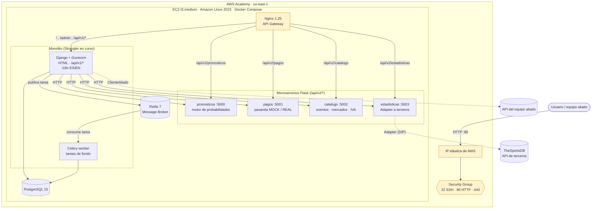
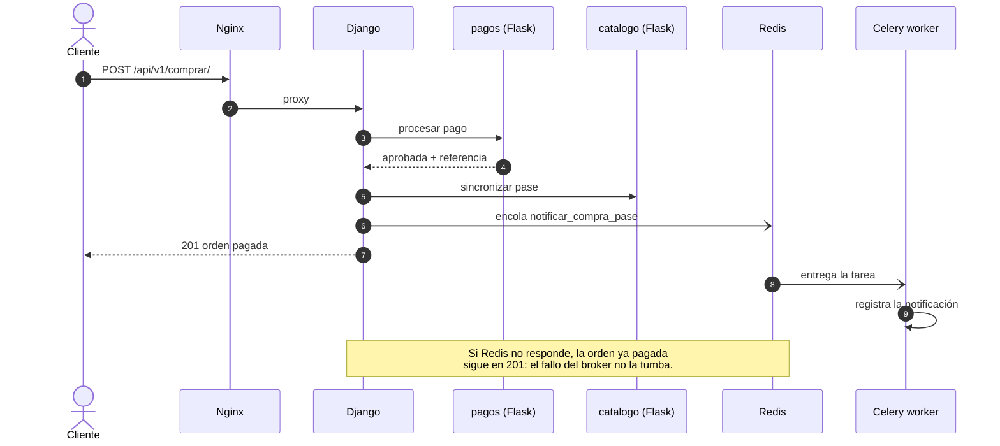

# Arquitectura de Pronostix (Entregable 2)

Ecosistema híbrido desplegado en **una instancia EC2 de AWS Academy** con Docker
Compose. Nginx es la única puerta pública; Django queda como orquestador del
monolito y la lógica de negocio migrada vive en cuatro microservicios Flask.

## 1. Despliegue en AWS

Solo el puerto 80 (Nginx) está publicado. Django (8000) y los Flask
(5000 a 5003) quedan en la red interna de Compose y no se alcanzan desde afuera.

## 2. Flujo de una compra (síncrono + asíncrono)

## 3. Estrategia Strangler

| Capacidad | Antes (Entregable 1) | Ahora | Ruta pública |
|---|---|---|---|
| Motor de pronósticos | `domain/modelo.py` en Django | `microservicio_pronosticos` | `/api/v2/pronosticos` |
| Pasarela de pago | `infra/gateways.py` en Django | `microservicio_pagos` | `/api/v2/pagos` |
| Catálogo, mercados, IVA | `services.py` en Django | `microservicio_catalogo` | `/api/v2/catalogo` |
| Estadísticas externas | llamada directa | `microservicio_estadisticas` | `/api/v2/estadisticas` |
| HTML, admin, compra v1 | Django | Django (orquestador) | `/`, `/admin`, `/api/v1/*` |

## 4. Resiliencia

- **Compra sin broker:** si Redis cae, la orden pagada responde 201 y se registra
  el aviso de que la notificación no se encoló.
- **Estadísticas externas caídas:** el Adapter degrada a "no disponible" y el
  detalle del evento sigue respondiendo 200.
- **Aliado caído o sin URL:** `ClienteAliado` muestra el contrato de respaldo.
- **Reinicio de la instancia:** los 9 servicios usan `restart: unless-stopped`.
